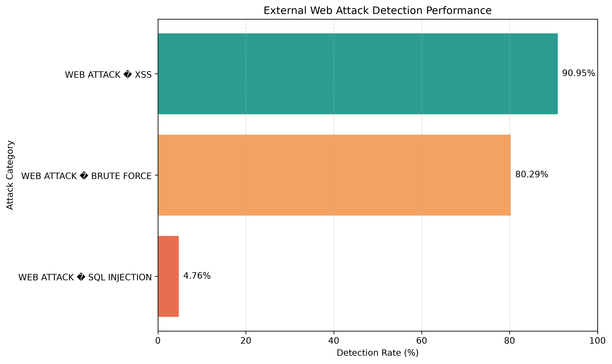

# AI-Based Network Intrusion Detection Using Machine Learning

## Overview

This project develops a machine-learning-based network intrusion detection system to classify network traffic as benign or Distributed Denial-of-Service (DDoS).

The project uses the CIC-IDS2017 dataset and a Random Forest classifier to establish a baseline for binary classification. Model performance is evaluated using precision, recall, F1-score, false-positive rate, and ROC-AUC.

The goal is to explore the application of machine learning to cybersecurity and establish a foundation for future research in explainable and trustworthy AI.

## Research Question

**How effectively can machine learning detect DDoS traffic, and how can we evaluate whether the model generalizes to unseen network traffic?**

## Dataset

- **Name:** CIC-IDS2017
- **Source:** [CIC-IDS2017 on Hugging Face](https://huggingface.co/datasets/bvsam/cic-ids-2017)
- **File:** `Friday-WorkingHours-Afternoon-DDos.pcap_ISCX.csv.parquet`
- **Task:** Binary classification
- **Classes:** `BENIGN` and `DDoS`

The selected dataset file initially contained 225,745 network-flow records. After removing 2,633 exact duplicate records, 223,112 records remained.

The dataset contains network-flow features describing packet lengths, traffic volumes, and other flow characteristics.

## Technologies

- Python 3.11
- pandas
- NumPy
- scikit-learn
- Matplotlib
- PyArrow
- Git and GitHub

## Methodology

The project follows these steps:

1. Load the CIC-IDS2017 Parquet dataset.
2. Inspect class labels, features, and duplicate records.
3. Remove exact duplicate rows for the second experiment.
4. Convert labels into a binary classification target.
5. Clean numeric features and handle infinite or missing values.
6. Exclude the destination-port feature in the second experiment.
7. Split the dataset into training and testing sets using an 80/20 stratified random split.
8. Train a Random Forest classifier.
9. Evaluate the model using classification metrics, a confusion matrix, and ROC-AUC.
10. Analyze feature importance to identify influential network-flow characteristics.

## Preliminary Results

The following results were obtained from the second experiment after removing duplicate rows and excluding the destination-port feature.

| Metric | Result |
|---|---:|
| Total records after deduplication | 223,112 |
| Test samples | 44,623 |
| True negatives | 19,018 |
| False positives | 1 |
| False negatives | 10 |
| True positives | 25,594 |
| False-positive rate | 0.000053 |
| ROC-AUC | 0.999978 |

The Random Forest achieved very high performance on a random holdout split from the selected dataset file.

**Important:** These are preliminary results, not evidence of real-world detection performance. A random split may place similar traffic patterns in both training and testing data. Evaluation on independent network captures is needed to investigate generalization to unseen traffic.

## Top Features

The ten most important features in the second experiment were:

1. Avg Fwd Segment Size
2. Fwd Packet Length Max
3. Total Length of Fwd Packets
4. Fwd Packet Length Mean
5. Subflow Fwd Bytes
6. Init_Win_bytes_forward
7. Bwd Packet Length Std
8. act_data_pkt_fwd
9. Fwd IAT Std
10. Bwd Packet Length Mean

These features describe packet sizes, data volumes, and traffic-flow behavior. Feature importance reflects how the trained model uses the features; it does not establish causation.

## Project Structure

```text
ai-intrusion-detection/
├── data/
│   └── machine_learning/
│       └── Friday-WorkingHours-Afternoon-DDos.pcap_ISCX.csv.parquet
├── results/
├── download.py
├── check_data.py
├── train.py
├── train_v2.py
├── requirements.txt
├── .gitignore
└── README.md
```

The dataset is stored locally and is excluded from Git tracking. The `results/` directory contains generated evaluation outputs when the scripts have been run.

## External Attack Detection Performance

The model was evaluated on an independent CIC-IDS2017 Thursday Web Attacks dataset using a classification threshold of 0.01.


### Detection Results

| Attack Category | Samples | Detected | Missed | Detection Rate |
|---|---:|---:|---:|---:|
| Web Attack – Brute Force | 1,507 | 1,210 | 297 | 80.29% |
| Web Attack – SQL Injection | 21 | 1 | 20 | 4.76% |
| Web Attack – XSS | 652 | 593 | 59 | 90.95% |

**Key finding:** The model detects XSS and brute-force attacks relatively well, but struggles to identify SQL injection attacks. These results highlight the challenges of generalizing from DDoS training data to different attack categories.

**Classification threshold:** 0.01

## Installation and Usage

### 1. Clone the repository

Replace `YOUR_GITHUB_USERNAME` with your GitHub username.

```bash
git clone https://github.com/YOUR_GITHUB_USERNAME/ai-intrusion-detection.git
cd ai-intrusion-detection
```

### 2. Create a virtual environment

On Windows PowerShell:

```powershell
python -m venv .venv
.\.venv\Scripts\Activate.ps1
```

### 3. Install dependencies

```powershell
python -m pip install -r requirements.txt
```

### 4. Download the dataset

Visit the [CIC-IDS2017 dataset on Hugging Face](https://huggingface.co/datasets/bvsam/cic-ids-2017).

Configure `download.py` with the correct repository-relative file path and download the selected Parquet file into the expected `data/` directory.

### 5. Inspect the dataset

```powershell
python .\check_data.py
```

### 6. Train the baseline model

```powershell
python .\train.py
```

### 7. Run the second experiment

```powershell
python .\train_v2.py
```

The scripts report evaluation metrics and save selected outputs to the `results/` directory.

## Limitations

- The current evaluation uses a random split from one dataset file.
- Related network flows may appear in both training and testing subsets.
- High performance on this dataset does not guarantee detection of unseen attacks.
- Feature importance is not equivalent to a causal explanation.
- The prototype has not been validated for production or live network deployment.

## Future Work

Planned extensions include:

- Evaluate the model on an independent network capture.
- Investigate time-based and group-based data splits.
- Compare Random Forest with Logistic Regression and other baseline classifiers.
- Integrate SHAP for individual prediction explanations.
- Evaluate probability calibration and model uncertainty.
- Investigate robustness under distribution shifts and unfamiliar traffic patterns.

## Research Relevance

This project explores AI/ML for cybersecurity, with an emphasis on intrusion detection, experimental rigor, interpretability, and generalization. It provides a starting point for investigating trustworthy machine learning in network security.

## External Web Attack Evaluation

### Overview

This project evaluates a Random Forest intrusion detection model trained on the CIC-IDS2017 Friday DDoS dataset and tested on the independent Thursday Web Attacks dataset.

The external test dataset contains 170,366 network-flow samples:

- Benign traffic: 168,186 samples
- Malicious traffic: 2,180 samples
- Attack categories: Brute Force, SQL Injection, and XSS

The model uses 67 training features and a probability threshold of 0.01 for the attack-category analysis.

### Detection Rate by Attack Category

The following results were obtained using a threshold of 0.01.

| Traffic category | Samples | Detected | Missed | Detection rate |
|---|---:|---:|---:|---:|
| Benign | 168,186 | 2,930 flagged | 165,256 not flagged | 1.74% false-positive rate |
| Web Attack – Brute Force | 1,507 | 1,210 | 297 | 80.29% |
| Web Attack – SQL Injection | 21 | 1 | 20 | 4.76% |
| Web Attack – XSS | 652 | 593 | 59 | 90.95% |

### Detection Rate Visualization



The results show that detection performance varies significantly across attack categories. XSS achieves the highest detection rate, followed by Brute Force. SQL Injection remains difficult to detect.

### Threshold Analysis

Changing the classification threshold changes the trade-off between attack detection and false positives.

| Threshold | Brute Force detection | SQL Injection detection | XSS detection | Benign samples flagged |
|---:|---:|---:|---:|---:|
| 0.001 | 80.56% | 52.38% | 95.55% | 6,250 |
| 0.002 | 80.56% | 52.38% | 95.55% | 5,675 |
| 0.005 | 80.49% | 14.29% | 95.09% | 4,177 |
| 0.010 | 80.29% | 4.76% | 90.95% | 2,930 |
| 0.020 | 0.00% | 4.76% | 0.00% | 1,857 |
| 0.050 | 0.00% | 0.00% | 0.00% | 982 |

Lower thresholds can improve the detection of certain attack categories, but they also increase false positives on benign traffic. The appropriate threshold depends on the acceptable balance between missed attacks and false alarms.

### Limitations

- The model is trained on DDoS traffic but evaluated on different web-attack categories, creating a cross-dataset and cross-attack generalization challenge.
- The SQL Injection test subset contains only 21 samples, so its detection rate is sensitive to individual predictions.
- Results depend on the selected threshold and dataset characteristics.
- A high overall accuracy can be misleading when benign traffic dominates the test dataset.
- These results represent offline evaluation and do not establish real-time detection performance.

### Reproducibility

The analysis scripts and generated results are available in this repository. The external evaluation and threshold analysis can be reproduced using the corresponding Python scripts and the required datasets.

## Author

**Pooja Singh**

GitHub: https://github.com/poojasingh91

This project is intended for educational and research purposes.